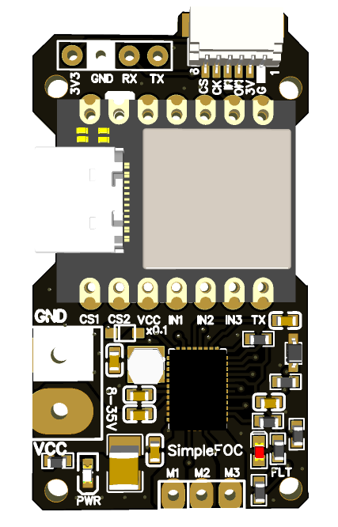
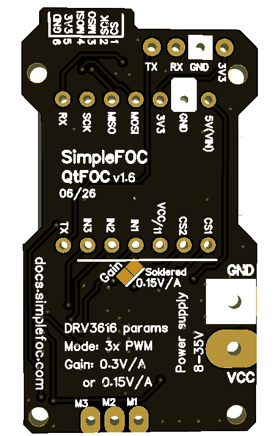
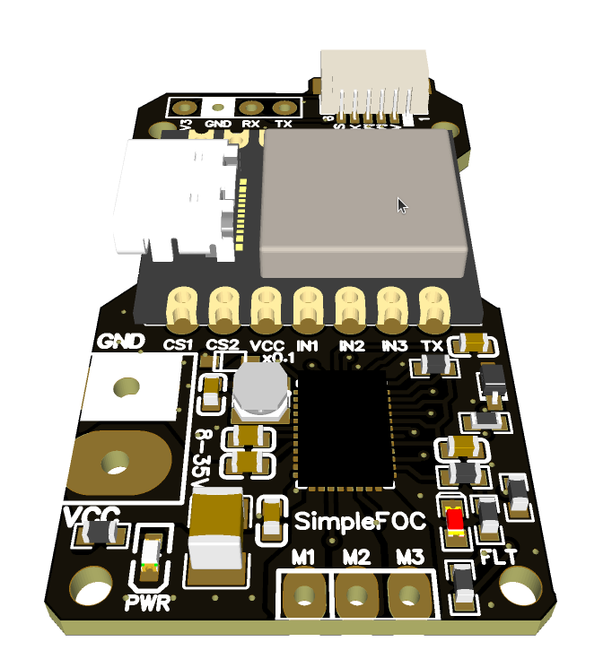

# *Simple**FOC*** *Qt**FOC*** *v1.6*


 



*Qt**FOC*** is a tiny, open-source, low-cost BLDC driver board in the form factor of the **Seeed Studio XIAO** / **Adafruit QT Py** boards. It is a part of the *Simple**FOC*** project and is designed to be fully compatible with the *Simple**FOC*** library.

You plug in a XIAO or QT Py, connect a motor and a power supply, and you have a complete FOC motor controller in a **21mm x 36mm** footprint. The board generates its own 5V supply from the motor power input, so the microcontroller is powered from VIN as well, and no extra regulator or USB cable is needed once it is programmed.

Like the other *Simple**FOC*** boards, it is also meant as a template project the community can modify:
- The board is simple and can be easily changed to fit different requirements.
- The board is designed in EasyEDA and all the fabrication files are available in this repository.

### Components
- **DRV8316C** integrated 3-phase driver - [datasheet](https://www.ti.com/lit/ds/symlink/drv8316.pdf)
   - Hardware configuration (no SPI configuration needed)
   - 3PWM mode (`R_MODE` = 47kΩ)
   - Integrated low-side current sense amplifiers: gain 0.15V/A (`GAIN` to GND)
   - Overcurrent protection: 16A level (`OCP/SR` to GND)
   - Slew rate: 200V/us (`SLEW` to AVDD)
   - Protections: undervoltage lockout, charge pump fault, overcurrent, overtemperature
   - Integrated buck converter: 5V output, 200mA max (inductor mode, 47uH)
- **Voltage divider** (47kΩ / 4.7kΩ) for power supply voltage measurement

### Features
- **Input voltage**: 8-35V
- **Current**: up to 8A peak (DRV8316 limit). The continuous current depends on cooling.
- **Current sensing**: 2 phase low-side current sensing (phases A and B), around ±11A range with a 3.3V ADC
- **Power supply measurement**: VIN/11 on `A2`
- **Onboard 5V buck**: powers the XIAO / QT Py from VIN through a diode, so USB and VIN can be connected at the same time
- **SPI JST-SH connector (6-pin)**: for SPI position sensors (for example AS5047, MT6701, AS5048A)
- **UART / GPIO header**: 3.3V, GND, RX, TX
- **Fault LED** (`nFAULT`) and **power LED**
- **Compact**: 21mm x 36mm
- **Compatible MCUs**: any board with the XIAO / QT Py pinout
   - Seeed Studio XIAO: SAMD21, RP2040, RP2350, nRF52840, ESP32-C3, ESP32-S3, ESP32-C6...
   - Adafruit QT Py: SAMD21, RP2040, ESP32-S2, ESP32-S3, ESP32-C3...
- **Open Source**:
   - Fully designed in **EasyEDA** - [EasyEDA project files](EasyEDA/)
   - Fully available fabrication files - [Gerber](Gerber/), [BOM](BOM_QtFOC_2026-11-17.csv), [Pick and Place](Pick%20and%20Place/)

## Pinout

The board uses the standard XIAO / QT Py pinout.

| XIAO / QT Py pin | Signal | Description |
| --- | --- | --- |
| `A0` / `D0` | SOA | Phase A current sense |
| `A1` / `D1` | SOB | Phase B current sense |
| `A2` / `D2` | VSENS | Supply voltage sense: VIN/11 (47kΩ / 4.7kΩ divider) |
| `D3` | IN1 | Phase A PWM |
| `D4` | IN2 | Phase B PWM |
| `D5` | IN3 | Phase C PWM |
| `D6` / `TX` | TX | UART TX (header) |
| `D7` / `RX` | CS / RX | SPI sensor chip select, UART RX (header) |
| `D8` | SCK | SPI clock |
| `D9` | MISO | SPI MISO |
| `D10` | MOSI | SPI MOSI |
| `5V` | 5V | Powered from the DRV8316 buck converter through a diode |
| `3V3` | 3.3V | 3.3V from the MCU board's regulator, used for logic and the sensor |

> **Note:** `D7` is shared between the SPI chip select (JST connector) and the RX pin on the UART header. You can use one of them at a time.

### Connectors

**Power** (screw terminal): `VCC` (8-35V) and `GND`

**Motor** (3-pin header): `M1`, `M2`, `M3`

**SPI** (JST-SH 1.0mm, 6-pin, SM06B-SRSS-TB):

Number | Pin | Function
--- | --- | ---
1 | GND | GND
2 | 3.3V | 3.3V
3 | D10 | MOSI
4 | D9 | MISO
5 | D8 | SCK
6 | D7 | CS

**UART / GPIO** (4-pin header): `3V3`, `GND`, `RX`, `TX`

## Getting started

A minimal *Simple**FOC*** setup with the board:

```cpp
#include <SimpleFOC.h>

BLDCMotor motor = BLDCMotor(7); // set your motor's pole pair number
BLDCDriver3PWM driver = BLDCDriver3PWM(D3, D4, D5);
// DRV8316 low-side current sense: 0.15V/A = 150mV/A, phases A and B
LowsideCurrentSense current_sense = LowsideCurrentSense(150.0f, A0, A1);
// SPI position sensor on the JST connector
MagneticSensorSPI sensor = MagneticSensorSPI(AS5047_SPI, D7);

void setup() {
  Serial.begin(115200);
  SimpleFOCDebug::enable(&Serial);

  sensor.init();
  motor.linkSensor(&sensor);

  driver.voltage_power_supply = 12; // your power supply voltage
  driver.init();
  motor.linkDriver(&driver);

  current_sense.linkDriver(&driver);
  current_sense.init();
  motor.linkCurrentSense(&current_sense);

  motor.torque_controller = TorqueControlType::foc_current;
  motor.controller = MotionControlType::velocity;
  motor.init();
  motor.initFOC();
}

void loop() {
  motor.loopFOC();
  motor.move(5); // 5 rad/s
}
```

The supply voltage can be measured on `A2`:

```cpp
float vin = analogRead(A2) * 3.3f / 4095.0f * 11.0f; // adjust for your ADC resolution
```

## Release log

Release | Date | Description
--- | --- | ---
v1.6 | 2026-02 | Initial public release

## License

The hardware design is released under the [MIT license](LICENSE).

## Community

For help and discussion, see the [SimpleFOC community forum](https://community.simplefoc.com) and the [SimpleFOC docs](https://docs.simplefoc.com).
